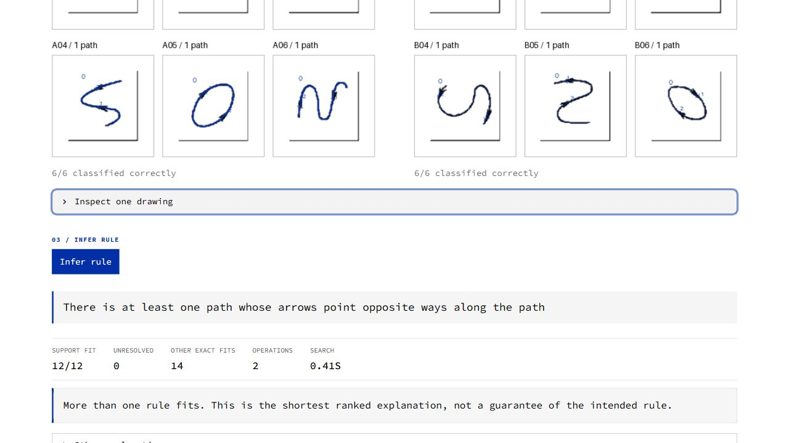

# Visual Rule Akinator & Bongard Solver

A local neuro-symbolic Python application with two modes and one shared symbolic engine. **Akinator** selects informative drawings and filters executable hypotheses. **Bongard** reads pixels as paths, closed regions, and unresolved entities, measures topology and arrow direction, then searches for an executable rule. Primitive shape recognition is an optional view of compatible closed regions. The original contour/CNN pipelines remain selectable experimental baselines.



## Run

The project environment is already installed in `.venv` on this machine. From this folder in PowerShell:

```powershell
.\.venv\Scripts\python.exe -m streamlit run app.py
```

Open <http://127.0.0.1:8501>. A convenience launcher is also supplied as `run.ps1`.

For a fresh installation with Python 3.11 or later:

```powershell
python -m venv .venv
.\.venv\Scripts\python.exe -m pip install -r requirements.txt
.\.venv\Scripts\python.exe -m streamlit run app.py
```

TensorFlow is optional for the app. To train and compare the fresh neural baseline, install `requirements-neural.txt`.

## Try both modes

1. In **Akinator**, secretly choose a supported rule such as “exactly four filled triangles,” “at least four filled triangles,” “four objects, all filled triangles,” or a positional rule. Press **Start session** and answer yes/no. An empty panel is an intentional query. Undo can correct a mistaken answer.
2. Observe the surviving program count and its history. When the available drawings no longer distinguish survivors, inspect the alternatives or request fresh drawings. A finite-pool agreement is not a logical-equivalence proof.
3. In **Bongard**, select Demo, Upload page, Separate groups or Camera. Press **Read drawings**, review the two aligned groups and object counts, then press **Infer rule**. Even demonstration pages are analyzed from pixels. The selected demo's target is never passed to the solver.
4. **Show detected objects** adds traced paths and arrow evidence. **Inspect one drawing** shows topology, arrows, along-path flow, region attributes, and unresolved evidence. **Generate examples** draws a checked matching example and counterexample. All panels are used by default; reserve panels through the evaluation setting.
5. Try your own clean page using `data/bongard_template.png`, or upload one tightly cropped image per panel into **Separate groups**. Black marker, white paper, closed shapes, and no overlapping ink are the safest starting conditions.
6. Try **Arrow directions / supplied drawing** for the user's original screenshot regression. The solver receives the original drawing pixels, not the expected direction annotations. Arrows are compared along each curve, not by their screen angle.
7. **Structural graph + symbolic** is the default. **Structural graph + neural regions** retains CNN distributions while guarding incompatible geometric labels. The original **OpenCV + symbolic** and **Neural perception + hard symbolic** modes reproduce the geometric baselines; they do not support path-flow reasoning.

The camera input captures a static photograph through Streamlit. Camera access depends on the browser and hardware; no webcam photograph was captured during automated verification. Optional page-boundary rectification and manual four-corner coordinates are supported. Arbitrary page parsing and continuous video are outside this version.

After six negative Akinator answers without a positive, a question may display up to four **independent** test drawings. Answer Yes if **any one** matches your rule, and No if **none** match. Positive batch answers are followed by individual probes to determine which drawing matched. This avoids exhaustive one-at-a-time tests of rare, specific rules. The current regression reports both question counts and drawings inspected, so it does not silently treat a batch as one visual example.

## Architecture

```text
Akinator: generated Scene + human yes/no labels
Bongard: pixels → panels → isolated ink
                  → skeleton graph + paths + region boundaries
                  → topology / arrows / optional guarded CNN attributes
                  → Scene with explicit unavailable evidence
Both: Scene → typed DSL → search / version space → executable rule
      executable rule → validated scene generation → deterministic drawing
```

- `src/scene`: validated region/path dataclasses, ordered centerlines, graph topology, arrow evidence, hard attributes and optional distributions, normalized geometry, and deterministic rendering. It has no OpenCV or TensorFlow dependency.
- `src/dsl`: compositional object/path predicates and executable rule ASTs. `Rule.assess(scene)` returns True, False, or None for unresolved evidence; missing arrow direction is never silently counted as a negative. Geometric/Akinator Boolean evaluation remains available.
- `src/synthesis`: exact or noisy ranking, cached predictions, ambiguity counts and semantic signatures. A beam of distinct prediction signatures expands promising pairs when the initial grammar has no perfect explanation.
- `src/active`: reproducible and constructive scene generation, deliberate selector/count coverage and near counterexamples, a persistent version space, queries balanced over distinct behaviors with grammar priors, optional union queries after repeated negatives, undo and checked answer generation.
- `src/vision`: image/page normalization, panel detection, contour hierarchy, stroke skeletonization and graph tracing, localized arrowhead measurement, arbitrary closed contours, guarded neural attributes, and evidence overlays. Segmentation and measurements never receive the group labels.
- `src/baselines`: raw-pixel prototypes and optional TensorFlow/Keras episodic prototypical training.
- `src/evaluation`: withheld panels, exact-program and sampled-semantic recovery, active/random comparison, clean/rotation/noise conditions, object/relation metrics and failure recording.
- `src/interface`: black/white/Klein-blue interface, compact Akinator workspace, staged Bongard input/review/inference, aligned contact sheets, evidence inspectors and exports. `app.py` is the launch entry point.

The application uses deterministic rendering, not a generative image model. Search composes primitives rather than looking up whole rule sentences.

## Rule example

```python
from src.dsl.nodes import Predicate, Exists, Count, And
from src.active import SceneGenerator
from src.synthesis import search

target = And(Exists(Predicate("shape", "circle")), Count(2))
examples = SceneGenerator(seed=42).balanced_examples(target, per_group=6)
result = search(examples)
best = result.ranked[0].rule
assert all(best.evaluate(scene) == label for scene, label in examples)
```

ForAll follows classical **vacuous truth**: every selected filled object is inside an outline object also holds when no filled objects exist. Combine it with `Exists(Predicate("filled"))` to require an actual filled object. Pair relations use distinct objects. Coordinates and areas are normalized to the panel; the actual shape outline is used for containment.

## Verify and reproduce results

```powershell
.\.venv\Scripts\python.exe -m pytest -q -p no:cacheprovider
.\.venv\Scripts\python.exe -m src.evaluation.structural_regression
.\.venv\Scripts\python.exe -m src.evaluation.experiments --episodes 10
.\.venv\Scripts\python.exe -m src.vision.attribute_cnn --epochs 12 --per-class 90
.\.venv\Scripts\python.exe -m src.evaluation.experiments --episodes 10 --neural --train-episodes 500 --attributes-model data/models/attributes.keras
```

The measured small pilot, its raw JSON/CSV, generated problem pages and trained whole-image encoder are in `data/pilot`. The trained object CNN and its independent synthetic validation are in `data/models`. Read `data/pilot/REPORT.md` before interpreting the numbers. The test suite covers DSL semantics, typing, canonicalization, containment, active querying/undo, ambiguous and contradictory support, generation timeouts, pixels-to-objects, panel labeling, color, rectification, probability validation/round trips, segmentation isolation, argmax reasoning, the uncertainty trigger and both UI flows.

The included pilot predates the expanded count grammar, constructive query coverage and batch protocol. It is preserved as a historical run and is labeled accordingly in the interface. Current four-filled-triangle regressions are in `data/regressions/akinator_counts.json`. Reproduce them with `python -m src.evaluation.akinator_regression`. The main experiment runner now records drawings seen as well as questions; rerun it before claiming current active/random performance.

Training uses six support examples and four query examples per class. Evaluation hides one example from each six-panel group and fits on the remaining ten panels. The first three target families train the fresh CNN; relational and composed targets are evaluation-only. Rotation and noise are tested separately on the same symbolic problems. Basic existence problems match object-count distributions across labels; conjunction negatives violate each clause separately. All remaining ambiguity is reported.

## What is complete and what remains

The application and synthetic experiment pipeline are implemented and runnable. See `docs/ACCEPTANCE.md` for evidence against each criterion. The current compared systems are whole-image pixel/CNN prototypes, OpenCV + symbolic reasoning, and neural object perception + hard symbolic reasoning. **A soft/probabilistic symbolic evaluator is planned, not implemented or measured.** Its required perception inputs are already preserved in `VisualObject`; implementing it will not require replacing the OpenCV segmentation, Akinator or hard evaluator.

**Broader real hand-drawn evaluation is pending.** One real arrow-path problem is available as crops of the user's screenshot in `data/fixtures/arrow_paths`. Fixed-rule image transforms, six leave-one-pair-out folds, group inversion, ordering, and negative controls are recorded in `data/regressions/structural_regression.json`. These are dependent regression cases, not an arbitrary-Bongard benchmark. Synthetic path generalization is recorded separately in `data/regressions/path_generalization.json`. `data/hand_drawn/manifest.example.json` and `docs/HAND_DRAWN_PROTOCOL.md` describe collection of independent problems. The original TensorFlow files and saved run were restored from the selected GitHub repository and are preserved unchanged; see `docs/BASELINE_PROVENANCE.md`.

Bounded search cannot recover every visual concept. Semantic drawings, ambiguous crossings, disconnected/broken arrowheads, high object counts, severely skewed pages and merged touching shapes can fail. Free-form boundaries retain their contours instead of being forced into triangle/circle labels. Optional ruling removal can confuse a large edge-aligned L drawing with a panel frame; disable it in Extraction settings when needed. Search reports unresolved coverage separately from wrong classifications, and it reports failure when no available rule explains all examples. See `docs/BONGARD_REDESIGN.md` for the implemented structural boundary and remaining extensions.

## References

The implementation follows the project's supplied `VISUAL_RULE_AKINATOR_BONGARD_FINAL.md` brief. API behavior was checked against [OpenCV contour hierarchy](https://docs.opencv.org/4.x/d9/d8b/tutorial_py_contours_hierarchy.html), [Streamlit camera input](https://docs.streamlit.io/develop/api-reference/widgets/st.camera_input) and [Keras models](https://www.tensorflow.org/api_docs/python/tf/keras/Model).
