# RGR: reproducible computer vision report

This export records the measurements actually supplied by the application. Missing work is marked incomplete; no benchmark scores are inferred from the model choice.

## Project reuse and model choice

The implementation reuses the Bongard project's object segmentation, project-pretrained shape/fill attribute CNN, geometric OpenCV classifier, and local inference. The compact CNN is selected because it already fits the project's object labels and supports adapting the shape head. Frozen-feature shape-head adaptation is transfer/adaptation within this project; it is not training a new general-purpose vision model. MobileNetV2 is considered as a pretrained neural alternative and is not trained or benchmarked in this report. ImageNet classes do not directly provide the project's geometric labels. The geometric pipeline provides a lightweight baseline. Their strengths are qualitative unless measured records are present.

| Model | Task | Advantages | Disadvantages | Resources | Fit and choice |
| --- | --- | --- | --- | --- | --- |
| Compact attribute CNN | Shape/fill classification of segmented objects | Trainable on personal examples; reports class confidence; existing project-pretrained checkpoint | Depends on segmentation; domain shift; confidence is not calibrated accuracy | TensorFlow/Keras; local checkpoint; 113,558 parameters; modest object crops | Chosen: reuses the project's attribute model and supports before/after fine-tuning |
| MobileNetV2 | General image classification / transferable image features | Compact general-purpose architecture; official Keras implementation; transferable features | ImageNet labels do not directly classify this project's geometric shapes; requires a new task head and labeled adaptation | TensorFlow/Keras; additional weights if ImageNet initialization is used | Considered, not trained or benchmarked here; less direct reuse than the existing narrow shape CNN |
| OpenCV geometric classifier | Contour-based shape/fill classification | Local, deterministic, lightweight; no training data or neural weights | Fixed geometry rules; broken/merged contours and irregular drawings can fail | CPU; OpenCV; no learned checkpoint | Existing geometric alternative and useful baseline; cannot be fine-tuned with gradients |

Architecture references: [official Keras MobileNetV2 API](https://www.tensorflow.org/api_docs/python/tf/keras/applications/MobileNetV2), [official TensorFlow transfer-learning guide](https://www.tensorflow.org/tutorials/images/transfer_learning). These describe the considered architecture and adaptation approach; they are not experimental scores.

## Dataset and settings

```json
{
  "source": "reproducible command-line experiment",
  "dataset_kind": "synthetic",
  "settings": {
    "threshold": 0.6,
    "brightness": 0,
    "contrast": 1,
    "size": 224,
    "rotation": 0,
    "flip": false
  },
  "dataset_fingerprint": "9deae2858bd6056176680be9dc4b5103c4ac62621ae86595ab36c549b429b27b",
  "split_seed": 2026,
  "preprocessing_id": "rgr-letterbox-bilinear-linear-tones-normalize48-v1",
  "base_model_sha256": "bd88f1884467a978c0af39a175c15fe07204e2f3b75331a6f568ff077ab15f60",
  "adapted_model_sha256": "08d81c4eb90282d3bcc88440a71bf0664ff5b08374af6c4e576b2d55d489de4f",
  "split_counts": {
    "train": 72,
    "validation": 24,
    "test": 24
  },
  "test_image": "synthetic/quadrilateral/2026_0000.png",
  "test_image_id": "084bcd17199c15a652ed7cfcfa19ff4af6f833285ccf922236b1ac2f3f45fc36",
  "sweep_model": "Pretrained CNN",
  "cnn_input": [
    48,
    48
  ],
  "sliders": [
    "confidence",
    "brightness",
    "contrast"
  ]
}
```

A synthetic demonstration is not evidence that the personal-photo assignment is complete. Photo provenance and ground-truth annotations must be supplied by the author. Train, validation and test images must remain separate.

## Measured results

Accuracy below uses only rows with explicit correctness or an available truth/prediction pair. Rejected cases count against accuracy and are listed separately from accepted classification errors. Unassessed rows are reported separately. Confidence is the model's reported score, not calibrated probability of correctness.

| Cohort | Model state | Images | Assessed | Correct | Errors | Rejected | Unassessed | Accuracy | Mean confidence |
| --- | --- | --- | --- | --- | --- | --- | --- | --- | --- |
| initial | before | 5 | 5 | 5 | 0 | 0 | 0 | 100.00% | 0.8981 |
| initial | after | 5 | 5 | 5 | 0 | 0 | 0 | 100.00% | 0.9066 |
| final | before | 5 | 5 | 5 | 0 | 0 | 0 | 100.00% | 0.9057 |
| final | after | 5 | 5 | 5 | 0 | 0 | 0 | 100.00% | 0.9654 |

### Initial cohort before/after

Stable same-image pairing: verified from supplied identifiers. Pairs: 5.

| Image | Truth | Before prediction | Before confidence | Before result | After prediction | After confidence | After result |
| --- | --- | --- | --- | --- | --- | --- | --- |
| synthetic/circle/2026_0026.png | circle | circle | 0.9899168610572815 | correct | circle | 0.9926839470863342 | correct |
| synthetic/polygon/2026_0009.png | polygon | polygon | 0.9499790668487549 | correct | polygon | 0.9948989748954773 | correct |
| synthetic/quadrilateral/2026_0000.png | quadrilateral | quadrilateral | 0.7947641015052795 | correct | quadrilateral | 0.7438374161720276 | correct |
| synthetic/triangle/2026_0029.png | triangle | triangle | 0.9746446013450623 | correct | triangle | 0.9732807874679565 | correct |
| synthetic/circle/2026_0022.png | circle | circle | 0.7812557816505432 | correct | circle | 0.8283045291900635 | correct |

Additional application metrics (before; preserved as supplied):

```json
{
  "total": 5,
  "correct": 5,
  "errors": 0,
  "rejected": 0,
  "accuracy": 1.0,
  "mean_confidence": 0.8981120824813843,
  "coverage": 1.0,
  "raw_accuracy": 1.0,
  "accepted_accuracy": 1.0
}
```

Additional application metrics (after; preserved as supplied):

```json
{
  "total": 5,
  "correct": 5,
  "errors": 0,
  "rejected": 0,
  "accuracy": 1.0,
  "mean_confidence": 0.9066011309623718,
  "coverage": 1.0,
  "raw_accuracy": 1.0,
  "accepted_accuracy": 1.0
}
```

### Final cohort before/after

Stable same-image pairing: verified from supplied identifiers. Pairs: 5.

| Image | Truth | Before prediction | Before confidence | Before result | After prediction | After confidence | After result |
| --- | --- | --- | --- | --- | --- | --- | --- |
| synthetic/polygon/2026_0026.png | polygon | polygon | 0.9054360389709473 | correct | polygon | 0.9927950501441956 | correct |
| synthetic/quadrilateral/2026_0002.png | quadrilateral | quadrilateral | 0.9883939027786255 | correct | quadrilateral | 0.953378438949585 | correct |
| synthetic/triangle/2026_0012.png | triangle | triangle | 0.9961875081062317 | correct | triangle | 0.9959869980812073 | correct |
| synthetic/circle/2026_0003.png | circle | circle | 0.8741890788078308 | correct | circle | 0.9043054580688477 | correct |
| synthetic/polygon/2026_0000.png | polygon | polygon | 0.7643917798995972 | correct | polygon | 0.980426549911499 | correct |

Additional application metrics (before; preserved as supplied):

```json
{
  "total": 5,
  "correct": 5,
  "errors": 0,
  "rejected": 0,
  "accuracy": 1.0,
  "mean_confidence": 0.9057196617126465,
  "coverage": 1.0,
  "raw_accuracy": 1.0,
  "accepted_accuracy": 1.0
}
```

Additional application metrics (after; preserved as supplied):

```json
{
  "total": 5,
  "correct": 5,
  "errors": 0,
  "rejected": 0,
  "accuracy": 1.0,
  "mean_confidence": 0.9653784990310669,
  "coverage": 1.0,
  "raw_accuracy": 1.0,
  "accepted_accuracy": 1.0
}
```

## Parameter experiments

Each row is an actual pipeline reading. Sweep values change one parameter at a time. Rejections retain their raw class prediction when available.

### Threshold

| Value | Prediction | Confidence | Accepted | Time (ms) |
| --- | --- | --- | --- | --- |
| 0.1 | quadrilateral | 0.7947641015052795 | True | 6.425300001865253 |
| 0.3 | quadrilateral | 0.7947641015052795 | True | 6.401299993740395 |
| 0.5 | quadrilateral | 0.7947641015052795 | True | 6.834800005890429 |
| 0.7 | quadrilateral | 0.7947641015052795 | True | 6.862199981696904 |
| 0.9 | quadrilateral | 0.7947641015052795 | False | 6.626599992159754 |

On the selected image, accepted threshold values were 0.1, 0.3, 0.5, 0.7; rejected threshold values were 0.9. This measures confidence filtering, rather than recall or accuracy over a dataset. These readings concern the selected image only; they do not establish dataset accuracy.

### Brightness

| Value | Prediction | Confidence | Accepted | Time (ms) |
| --- | --- | --- | --- | --- |
| -100 | no class (rejected) | 0.0 | False | 0.9618999902158976 |
| -50 | quadrilateral | 0.9952948689460754 | True | 6.152100017061457 |
| 0 | quadrilateral | 0.7947641015052795 | True | 6.5805999911390245 |
| 50 | triangle | 0.931740939617157 | True | 6.026399991242215 |
| 100 | no class (rejected) | 0.0 | False | 0.836799998069182 |

Class/no-class transitions were -100 → -50: no class (rejected) → quadrilateral; 0 → 50: quadrilateral → triangle; 50 → 100: triangle → no class (rejected). Rejected values were -100, 100. Reported confidence ranged from 0.0000 to 0.9953. Confidence is uncalibrated and is not evidence of correctness. These readings concern the selected image only; they do not establish dataset accuracy.

### Contrast

| Value | Prediction | Confidence | Accepted | Time (ms) |
| --- | --- | --- | --- | --- |
| 0.5 | quadrilateral | 0.7555970549583435 | True | 6.455900002038106 |
| 1.0 | quadrilateral | 0.7947641015052795 | True | 6.372599978931248 |
| 2.0 | quadrilateral | 0.8208677768707275 | True | 6.151799985673279 |

The raw predicted class stayed unchanged across the recorded settings. Rejected values were none. Reported confidence ranged from 0.7556 to 0.8209. Confidence is uncalibrated and is not evidence of correctness. These readings concern the selected image only; they do not establish dataset accuracy.

### Size

| Value | Prediction | Confidence | Accepted | Time (ms) |
| --- | --- | --- | --- | --- |
| 128 | quadrilateral | 0.8057012557983398 | True | 5.698600027244538 |
| 224 | quadrilateral | 0.7947641015052795 | True | 6.048499984899536 |
| 320 | quadrilateral | 0.743270754814148 | True | 8.867199998348951 |
| 416 | quadrilateral | 0.7745966911315918 | True | 10.456399992108345 |
| 640 | quadrilateral | 0.7443475723266602 | True | 19.666399981360883 |

Confidence did not improve monotonically as the tested input sizes increased. Fastest recorded single run: input size 128, 5.699 ms. One timing run does not establish stable throughput or a speed guarantee; hardware, caching and warm-up affect it. Confidence is not calibrated accuracy. These readings concern the selected image only; they do not establish dataset accuracy.

### Augmentation

| Value | Prediction | Confidence | Accepted | Time (ms) |
| --- | --- | --- | --- | --- |
| original | quadrilateral | 0.7947641015052795 | True | 6.886899995151907 |
| rotate20 | polygon | 0.42931583523750305 | False | 7.419800007482991 |
| hflip | quadrilateral | 0.8270475268363953 | True | 6.194699992192909 |

original: prediction quadrilateral; confidence 0.7948; confidence change versus original +0.0000; recorded result correct.

rotate20: prediction polygon; confidence 0.4293; confidence change versus original -0.3654; recorded result rejected.

hflip: prediction quadrilateral; confidence 0.8270; confidence change versus original +0.0323; recorded result correct.

Confidence changes do not establish accuracy changes. These readings concern the selected image only; they do not establish dataset accuracy.

## Recorded adaptation

```json
{
  "source": "synthetic_demo",
  "adaptation": "Only the shape head is fine-tuned; visual features and fill head are frozen.",
  "epochs": 4,
  "selected_epoch": 3,
  "checkpoint_selection": "validation accuracy, then validation loss",
  "trainable_parameters": 132,
  "split_counts": {
    "train": 72,
    "validation": 24,
    "test": 24
  },
  "augmentation": [
    "training-only rotation ±10 degrees",
    "training-only horizontal flip",
    "training-only brightness and contrast"
  ],
  "before": {
    "accuracy": 1.0,
    "correct": 24,
    "incorrect": 0,
    "count": 24,
    "mean_confidence": 0.9321541786193848
  },
  "after": {
    "accuracy": 1.0,
    "correct": 24,
    "incorrect": 0,
    "count": 24,
    "mean_confidence": 0.9588534235954285
  },
  "limitations": [
    "Synthetic demo images are drawings, not real photographs; use personal photographs for the assignment.",
    "Softmax probabilities are uncalibrated.",
    "Head fine-tuning does not guarantee an improvement on unseen photographs.",
    "Exact duplicate pixels are grouped; independently edited copies must be excluded before import."
  ]
}
```

Epoch-by-epoch readings and source split manifests are preserved in analysis.json and the training CSV tables. Validation selects the checkpoint; test metrics do not select an epoch.

Training-record raw test accuracy stayed unchanged: 100.00% before → 100.00% after (+0.00 percentage points). These are the recorded test-split values, not an estimate for all future images.

Recorded mean confidence changed from 0.9322 to 0.9589 (+0.0267). A confidence change is separate from an accuracy change; the scores are uncalibrated.

## Assignment coverage

| Task | Requirement | Status | Evidence / limitations |
| --- | --- | --- | --- |
| 1 | Compare at least two models and justify the choice | complete | 3 Compact attribute CNN chosen; MobileNetV2 considered, not benchmarked; OpenCV geometric baseline. Qualitative comparison, no invented benchmark scores. |
| 2 | Pretrained model on at least five new personal photographs with truth, prediction, confidence and correctness | incomplete | {"images": 5, "assessed": 5, "correct": 5, "errors": 0, "rejected": 0, "incorrect_or_rejected": 0, "unassessed": 0, "accuracy": 1.0, "mean_confidence": 0.8981120824813843, "confidence_records": 5} Synthetic examples demonstrate the workflow but do not satisfy the personal-photo requirement. |
| 3 | Threshold sweep at 0.1, 0.3, 0.5, 0.7, 0.9 | complete | {"values": [0.1, 0.3, 0.5, 0.7, 0.9], "records": 5, "complete_readings": true, "valid_timing": null} Classification confidence threshold; this is not a detector's bounding-box threshold. |
| 4 | Brightness sweep at -100, -50, 0, 50, 100 | complete | {"values": [-100, -50, 0, 100, 50], "records": 5, "complete_readings": true, "valid_timing": null}  |
| 5 | Contrast sweep at 0.5, 1, 2 | complete | {"values": [0.5, 1.0, 2.0], "records": 3, "complete_readings": true, "valid_timing": null}  |
| 6 | Size sweep at 128, 224, 320, 416, 640 with timing | complete | {"values": [128, 224, 320, 416, 640], "records": 5, "complete_readings": true, "valid_timing": true}  |
| 7 | Original plus at least two augmentations with predictions and confidence | complete | ["hflip", "original", "rotate20"] An explicit rejection/no-class result is a measured outcome, not an invented prediction. |
| 8 | Personal dataset, train/validation/test split, fine-tuning and saved model | incomplete | {"split_counts": {"train": 72, "validation": 24, "test": 24}, "model_saved": true, "training_recorded": true} Evaluation photos must be excluded from fitting and augmentation of training data. |
| 9 | Same five test photographs before/after and at least three visual Before → After comparisons | incomplete | {"same_image_pairs": 5, "comparison_illustrations": 3} Pairing requires stable unique image IDs or image digests in both model results. Static comparisons are included; interactive views remain in the application. |
| 10 | Five new final test photographs, correct/errors/mean confidence/Accuracy, and at least three sliders | incomplete | {"images": 5, "assessed": 5, "correct": 5, "errors": 0, "rejected": 0, "incorrect_or_rejected": 0, "unassessed": 0, "accuracy": 1.0, "mean_confidence": 0.9653784990310669, "confidence_records": 5, "distinct_from_initial": true, "declared_slider_count": 3, "same_image_before_after_pairs": 5} Slider count is application evidence declared in the payload; ZIP exports contain static images. Image IDs must be disjoint from the initial cohort. |

## Interpretation and limits

Threshold experiments filter class-confidence outputs; they are not object-detector localization experiments. Size timing describes the actual pipeline settings recorded in the tables. The CNN may internally resize crops to its fixed training resolution, so page/input size does not imply a changed neural architecture.

Image transformations can alter pixel measurements and classification. Fine-tuning can improve or worsen unseen results; use the recorded before/after values and independent final cohort to judge it. Small cohorts and uncalibrated confidence limit generalization claims. Training-record accuracy uses unthresholded argmax predictions; the interactive comparison tables apply the selected confidence threshold.

The ZIP includes analysis.json with the original readings, derived_summaries.json, requirement_coverage.csv, and CSV tables for supplied record lists. Empty or absent sections are not silently replaced with example measurements.

## Supplied illustrations

### selected_original

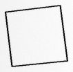

### selected_processed


### original

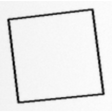

### rotate20

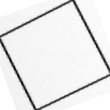

### hflip

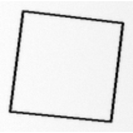

### 1_before

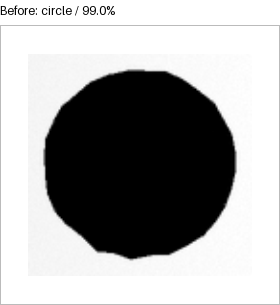

### 1_after

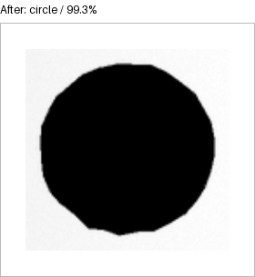

### 2_before

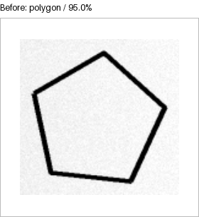

### 2_after


### 3_before

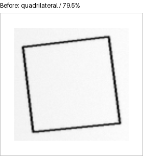

### 3_after

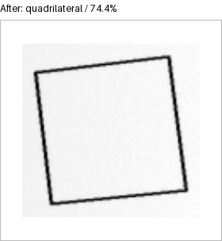

### 1

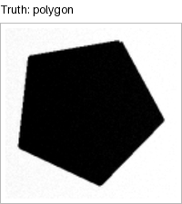

### 2

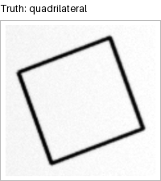

### 3

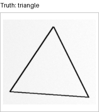

### 4

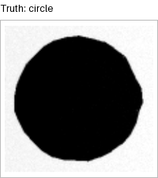

### 5

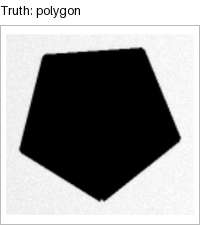
