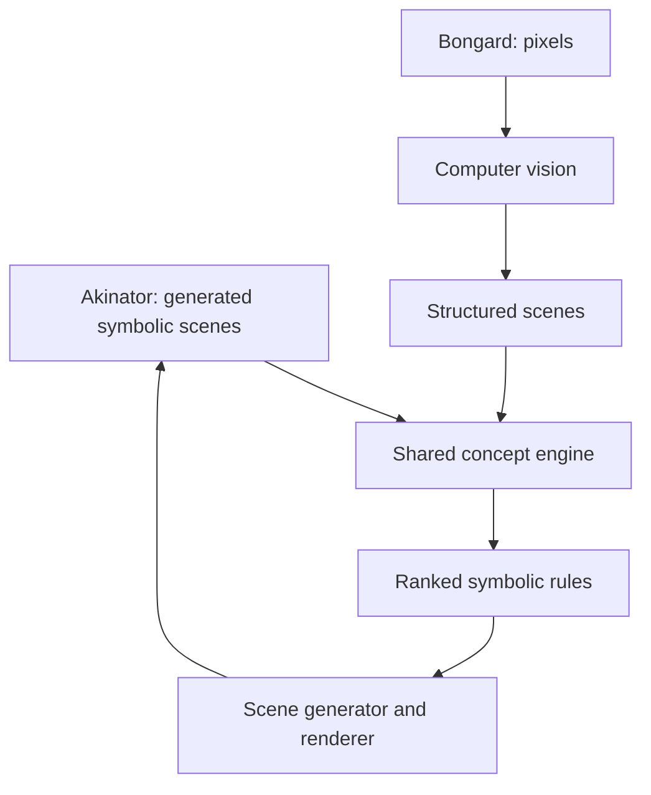

# Visual Rule Akinator + Bongard Solver

> Final project specification and Codex development handoff\
> Status: authoritative project direction\
> Intended scope: university computer-vision project, approximately 10 weeks × 5 hours/week\
> Main language: Python\
> Current ML framework: TensorFlow/Keras\
> Main CV library: OpenCV

---

## 1. Project in one sentence

Build a system with a shared symbolic concept-discovery engine that can:

1. infer a person's hidden visual rule by actively generating examples and asking yes/no questions; and
2. use computer vision to solve uploaded, scanned, or carefully photographed Bongard-style problems, explain the separating rule, and draw new positive and negative examples.

The Akinator mode demonstrates active reasoning. The Bongard mode supplies the genuine computer-vision problem. Both modes use the same rule representation, evaluator, search system, scene generator, and renderer.

---

## 2. Final project title

### Recommended title

**Visual Rule Akinator: Active Neuro-Symbolic Concept Discovery and Bongard Problem Solving**

### Short classroom title

**Visual Rule Akinator and Bongard Solver**

### Research question

> Can an interpretable symbolic concept learner recover visual rules from fewer examples through active questioning, and how robustly can the same learner solve Bongard-style problems when its structured input must first be extracted from pixels?

### Secondary questions

- Does active query selection require fewer labeled examples than passive Bongard-style inference?
- Does explicit object-and-relation representation generalize better than a pixel-based neural baseline?
- How do perception errors affect symbolic rule recovery?
- When several rules fit the same examples, can the system expose the ambiguity and generate a useful disambiguating example?

---

## 3. The most important architectural decision

The two modes do not use computer vision in the same way.

| Mode | Input | Uses CV? | Main purpose |
|---|---|---:|---|
| Visual Akinator | System-generated scenes plus human yes/no answers | No | Active rule discovery |
| Bongard Solver | Uploaded, scanned, drawn, or photographed examples | Yes | Visual perception followed by rule discovery |
| Shared output system | Inferred symbolic program | No | Draw new positive and negative examples |

### Why Akinator mode does not need CV

The Akinator creates a symbolic scene before rendering it:

```python
Scene([
    Object(shape="triangle", color="red", filled=True, x=0.25, y=0.45),
    Object(shape="square", color="blue", filled=False, x=0.75, y=0.50),
])
```

Because the system already knows this scene description, applying CV to its own rendered image would be artificial and unnecessary.

### Why Bongard mode does need CV

The Bongard solver receives only pixels. It must extract objects and relations before symbolic reasoning is possible:

```text
pixels
  → panel detection
  → object/contour detection
  → object attributes
  → spatial and topological relations
  → symbolic scene
  → program search
  → inferred rule
```

The project is therefore not claiming that every subsystem is computer vision. It is a combined CV and symbolic-AI system.

---

## 4. What is given and what must be discovered

In a standard Bongard problem, the examples are already divided into two groups.

| Information | How the system obtains it |
|---|---|
| Which examples belong to the left group | Page layout or user interface |
| Which examples belong to the right group | Page layout or user interface |
| Objects inside each example | Computer vision |
| Object properties and relationships | CV plus geometric calculations |
| The rule that distinguishes the groups | Symbolic program search |
| New drawings obeying or violating the rule | Symbolic scene generation and rendering |

Assigning the left group label `1` and the right group label `0` is not hardcoding the answer. It is supervision supplied by the problem format. The unknown is the visual property separating the groups.

It is often clearer to call them **Group A** and **Group B**, because “positive” and “negative” are arbitrary. Reversing the labels merely negates the inferred rule.

### Complete-page input

For a conventional page containing six examples on each side:

1. detect or define the central divider;
2. detect the twelve large example panels;
3. assign panels left of the divider to Group A;
4. assign panels right of the divider to Group B;
5. crop and analyze every panel independently.

Simplified prototype:

```python
for panel in detected_panels:
    label = 1 if panel.center_x < divider_x else 0
    scene = vision.extract_scene(panel.image)
    examples.append((scene, label))
```

This reads the task format. It does not encode the hidden rule.

---

## 5. System overview



### Shared concept engine

The shared engine contains:

- a typed domain-specific language (DSL);
- an evaluator that executes a rule on a scene;
- a program enumerator/searcher;
- consistency and complexity scoring;
- ambiguity detection;
- scene generation;
- natural-language verbalization;
- optional active information-gain selection.

---

## 6. Mode A: Visual Rule Akinator

### Interaction

1. A person silently chooses a rule expressible in the DSL.
2. The system creates and renders a candidate scene.
3. The person answers **yes** if it follows the secret rule and **no** otherwise.
4. The system removes candidate programs inconsistent with that answer.
5. It selects a new scene that best separates the remaining hypotheses.
6. It stops when one rule, or a very small set of rules, remains.
7. It verbalizes the result and draws verification examples.

### Version-space update

Let $H$ be the current set of candidate rules. For a scene $x$ and user answer $y$:

$$
H' = \{h \in H : h(x)=y\}
$$

No neural weights need to change during this interaction. The system is eliminating symbolic hypotheses.

### Active query selection

For each possible scene, divide the remaining rules into:

- rules predicting **yes**;
- rules predicting **no**.

Prefer a scene that makes this split as balanced as possible:

$$
x^* = \arg\min_x \left|\#H_{yes}(x)-\#H_{no}(x)\right|
$$

An equivalent implementation can maximize expected entropy reduction or information gain.

### Why this is not merely a dictionary lookup

The system should not store complete rules such as:

```text
two triangles to the left of one rectangle
```

It stores reusable primitives:

```text
Triangle
Rectangle
Exactly
LeftOf
AND
```

Program synthesis composes them into rules never explicitly listed as complete entries.

### Akinator output

```text
My best hypothesis:

There are exactly two triangles, and every triangle is left of a rectangle.

5 of 824 original hypotheses remain.
Confidence is limited because two alternative rules still fit every answer.
```

The system should show surviving-hypothesis counts after each answer. This makes the reasoning visually understandable.

---

## 7. Mode B: Bongard Solver

### Supported inputs

Priority order:

1. clean generated Bongard-style images;
2. uploaded clean scans or digital drawings;
3. photographs of drawings using a controlled template;
4. webcam snapshot of the controlled template;
5. continuous video only as a stretch goal.

### Bongard workflow

1. Receive a complete page or separately supplied Group A and Group B examples.
2. Detect and crop each example panel.
3. Convert every panel from pixels into a structured scene.
4. Generate candidate symbolic programs.
5. Execute each program on every scene.
6. Keep or rank programs that separate the groups.
7. Return the simplest strong explanations.
8. Highlight evidence inside the original panels.
9. Generate new positive examples and counterexamples.

### Desired output

```text
Best inferred rule:
Every filled object is inside an outline object.

Training consistency: 12/12
Complexity: 5 operations

Alternative:
Every circle is inside a larger object.
Training consistency: 11/12
```

The application should not conceal ambiguity. If several rules fit, it should display the alternatives or generate a disambiguating scene.

---

## 8. Hand-drawn input and webcam scope

### Realistic hand-drawn scope

The first version can support:

- black marker on white paper;
- circles, triangles, quadrilaterals, and arbitrary closed contours;
- filled versus outline shapes;
- approximate size;
- object count;
- left/right and above/below;
- containment;
- touching or intersection;
- approximate alignment and collinearity.

It should not initially claim support for arbitrary semantic drawings such as animals, facial expressions, or “objects looking at each other.”

### Recommended live-camera design

Use a live preview with a **Capture** button:

1. display webcam preview;
2. user places a completed page or template in view;
3. user presses **Capture**;
4. freeze one frame;
5. correct perspective;
6. normalize lighting;
7. detect panels and objects;
8. solve the static problem.

This feels live during a presentation but avoids unnecessary temporal complexity.

### Why continuous video is postponed

True real-time processing adds:

- motion blur;
- camera movement;
- flickering detections;
- tracking and object identity across frames;
- incomplete drawings;
- changing hypotheses while the scene is moving;
- temporal smoothing and stability logic.

These problems do not strengthen the main research question enough to justify the time cost. Snapshot-based webcam input is the correct target for the course project.

### Recommended paper template

Provide clearly outlined cells under two headings:

```text
GROUP A                      GROUP B
[cell] [cell]                [cell] [cell]
[cell] [cell]                [cell] [cell]
[cell] [cell]                [cell] [cell]
```

Four corner markers can make perspective correction reliable. The template is an engineering constraint, not cheating.

---

## 9. Computer-vision pipeline

### 9.1 Page normalization

- Convert to grayscale.
- Detect page boundary or four reference markers.
- Apply a perspective transform.
- Normalize contrast or use adaptive thresholding.
- Remove the title, margins, and central binding region when present.

### 9.2 Panel detection

Possible methods:

- find large rectangular contours;
- cluster rectangles into left and right groups;
- use a known template grid;
- allow manual corner selection as a fallback.

The template-grid method is recommended first. Automatic arbitrary-page parsing is an extension.

### 9.3 Object extraction per panel

OpenCV operations:

- thresholding;
- morphological opening/closing;
- `findContours`;
- contour hierarchy;
- connected-component analysis;
- polygon approximation;
- ellipse/circle fitting;
- centroid and area calculation.

### 9.4 Object attributes

Represent, where available:

```python
Object(
    id=0,
    shape="triangle",
    filled=False,
    color="black",
    center=(0.31, 0.58),      # normalized panel coordinates
    area=0.07,                # normalized area
    angle=18.0,
    contour=[...],
)
```

### 9.5 Relations

Derive relations from measurements:

- `LeftOf(a,b)`
- `RightOf(a,b)`
- `Above(a,b)`
- `Below(a,b)`
- `Inside(a,b)`
- `Touching(a,b)`
- `Overlapping(a,b)`
- `Near(a,b)`
- `LargerThan(a,b)`
- `SameShape(a,b)`
- `SameSize(a,b)`
- `Aligned(a,b,c)`
- `ApproximatelyCollinear(group)`

Every fuzzy geometric predicate must expose its tolerance. For example:

```python
def left_of(a, b, margin=0.05):
    return a.center_x < b.center_x - margin
```

### 9.6 Perception confidence

Later versions can attach confidence:

```python
shape_probabilities = {
    "circle": 0.72,
    "polygon": 0.24,
    "unknown": 0.04,
}
```

The first version may use deterministic OpenCV features, but it should record unknown or uncertain detections instead of silently inventing confident objects.

---

## 10. Structured scene representation

```python
@dataclass
class VisualObject:
    id: int
    shape: str
    filled: bool
    color: str
    center_x: float
    center_y: float
    area: float
    angle: float

@dataclass
class Scene:
    objects: list[VisualObject]
    relations: set[tuple]
```

Example:

```python
Scene(
    objects=[
        VisualObject(0, "triangle", True, "red", 0.25, 0.45, 0.08, 10),
        VisualObject(1, "square", False, "red", 0.72, 0.48, 0.10, 0),
    ],
    relations={
        ("left_of", 0, 1),
        ("same_color", 0, 1),
        ("smaller_than", 0, 1),
    },
)
```

This scene representation is the boundary between computer vision and reasoning. The symbolic engine should not depend on OpenCV image details.

---

## 11. Initial domain-specific language

The DSL is compositional. “Any rule” means any rule expressible as a composition of its primitives.

### Properties

```text
Circle(x)
Triangle(x)
Quadrilateral(x)
Filled(x)
Outline(x)
Small(x)
Large(x)
Color(x, c)
```

### Relations

```text
LeftOf(x, y)
Above(x, y)
Inside(x, y)
Touching(x, y)
Overlapping(x, y)
Near(x, y)
LargerThan(x, y)
SameShape(x, y)
SameColor(x, y)
Aligned(x, y, z)
```

### Quantifiers and counting

```text
Exists(x, expression)
ForAll(x, expression)
Exactly(n, x, expression)
AtLeast(n, x, expression)
Count(predicate)
```

### Logical and numerical operators

```text
AND
OR
NOT
IMPLIES
Equal
GreaterThan
LessThan
ApproximatelyEqual
```

### Example programs

```text
Exactly(2, x, Triangle(x))
```

```text
Exists(x, Circle(x) AND Filled(x))
```

```text
Exists(x, y,
    Triangle(x)
    AND Quadrilateral(y)
    AND LeftOf(x, y)
    AND SameColor(x, y)
)
```

```text
ForAll(x, Triangle(x) IMPLIES Filled(x))
```

```text
Count(Circle) > Count(Triangle)
```

### Initial depth limit

Begin with programs of depth 1–3. Add depth 4 only after pruning and deduplication work. A small correct language is better than an enormous unusable search space.

---

## 12. Rule evaluation

Every rule is an executable syntax tree:

```python
class Rule:
    def evaluate(self, scene: Scene) -> bool:
        ...
```

Example:

```python
class ExistsLeftOf:
    def __init__(self, left_predicate, right_predicate):
        self.left_predicate = left_predicate
        self.right_predicate = right_predicate

    def evaluate(self, scene):
        for a in scene.objects:
            for b in scene.objects:
                if a.id == b.id:
                    continue
                if (
                    self.left_predicate(a)
                    and self.right_predicate(b)
                    and ("left_of", a.id, b.id) in scene.relations
                ):
                    return True
        return False
```

Rules must be executable both for:

- testing whether a scene belongs to a group; and
- validating scenes produced by the answer generator.

---

## 13. Program search

### Basic search

1. Generate all valid programs at depth 1.
2. Evaluate them on every labeled scene.
3. Remove or penalize inconsistent programs.
4. Canonicalize and deduplicate equivalent expressions.
5. If no adequate rule exists, expand to the next depth.
6. Rank rules by consistency and simplicity.

### Recommended score

$$
Score(h) =
Accuracy(h)
- \lambda\,Complexity(h)
- \mu\,Uncertainty(h)
$$

For exact synthetic experiments, require perfect consistency and use complexity only to rank survivors. For hand-drawn inputs, allow small errors because perception can be imperfect.

### Necessary pruning

- typed arguments;
- maximum depth;
- canonical ordering for commutative operations;
- reject contradictions;
- cache evaluation results;
- semantic deduplication over the current dataset;
- stop expanding already useless branches;
- prefer minimum-description-length rules.

For example, normalize:

```text
A AND B
B AND A
```

to the same canonical representation.

### Ambiguity

Several rules may perfectly fit a small dataset. The application should:

- return the top few rules;
- report how many hypotheses remain;
- prefer shorter rules;
- generate a scene on which the best candidates disagree;
- ask the user for another label when interaction is allowed.

Ambiguity is not a bug. Handling it explicitly is part of the research contribution.

---

## 14. Drawing new answers

The project does not need a text-to-image model. It should generate a symbolic scene and render it deterministically.

### Positive answer

```python
scene = generate_scene()
if inferred_rule.evaluate(scene):
    return renderer.draw(scene)
```

### Counterexample

```python
scene = generate_scene()
if not inferred_rule.evaluate(scene):
    return renderer.draw(scene)
```

### Generation strategies

#### Rejection sampling

Generate random scenes and keep those satisfying the rule. This is simple and suitable for common rules.

#### Guided generation

Construct required objects and relations directly from the program. This is needed for rare or highly constrained rules.

Recommended order:

1. implement rejection sampling;
2. measure failure/timeouts;
3. add guided constructors only for important difficult predicates.

### Evidence overlay

The renderer can highlight:

- the objects that satisfy the rule in green;
- the violating object in red;
- relevant relations with arrows or lines;
- textual evaluation steps.

This makes the final demonstration much stronger than returning only a sentence.

---

## 15. Role of machine learning and TensorFlow

The main reasoning engine is symbolic, not a neural network. This is intentional.

TensorFlow can still be used for:

- the existing pixel-based few-shot baseline;
- optional learned shape classification;
- optional segmentation under noisy drawings;
- later learned guidance for program search.

The Akinator interaction does not retrain a neural model after every answer. It filters symbolic candidate programs.

The project is a valid AI and CV project even if OpenCV performs the first visual extraction. Scientific value comes from the system design and comparison, not from maximizing neural-network size.

---

## 16. Existing implementation

The workspace already contains:

- `tensorflow-conversion/bongard_tensorflow.py`
- `tensorflow-conversion/bongard_first_milestone.ipynb`
- `tensorflow-conversion/bongard_results/`

The existing code is a TensorFlow few-shot/prototypical-learning baseline over generated 48×48 grayscale shape scenes.

### Existing rule families

- contains a circle;
- contains a filled object;
- contains exactly two objects.

### Existing episode structure

- 6 positive support images;
- 6 negative support images;
- 8 query images;
- labels are produced by the synthetic generator;
- a CNN embeds images;
- positive and negative class prototypes are computed;
- query images are classified by distance to the prototypes.

### Existing CNN

Approximately:

```text
48×48×1
→ Conv2D
→ MaxPool
→ Conv2D
→ MaxPool
→ Flatten
→ Dense embedding
```

The stored model has approximately 79,680 parameters.

### Stored results

Familiar rendering style:

| System | Circle | Filled | Two objects | Mean |
|---|---:|---:|---:|---:|
| Pixel baseline | 60.00% | 66.25% | 100.00% | 75.42% |
| Untrained CNN | 64.38% | 66.25% | 100.00% | 76.88% |
| Trained CNN | 99.38% | 95.00% | 100.00% | 98.13% |

Combined rotation and noise shift:

| System | Circle | Filled | Two objects | Mean |
|---|---:|---:|---:|---:|
| Pixel baseline | 51.25% | 58.75% | 96.25% | 68.75% |
| Trained CNN | 61.25% | 90.63% | 83.75% | 78.54% |

### Honest interpretation

The current implementation:

- demonstrates few-shot visual classification;
- does not recover a symbolic rule;
- does not solve arbitrary Bongard problems;
- does not yet contain active Akinator questioning;
- is useful as a neural baseline, not as the final system.

The rotation and noise conditions should be separated in future experiments instead of combined into one shift.

---

## 17. Experimental design

### Systems to compare

| System | Representation | Output |
|---|---|---|
| Pixel-distance baseline | Raw pixels | Class prediction |
| TensorFlow prototypical baseline | Neural embedding | Class prediction |
| Passive symbolic solver | Structured objects/relations | Executable rule |
| Active symbolic Akinator | Structured objects/relations plus selected queries | Executable rule |
| Bongard solver with CV | Pixels converted to structured scenes | Executable rule |

### Two kinds of generalization

#### Image-level generalization

The rule type is familiar, but positions, rotations, sizes, line thickness, noise, and drawing style change.

#### Concept-level generalization

The exact target program was never used as a complete training rule, but it can be composed from known primitives.

Do not confuse these two claims.

### Recommended metrics

- held-out scene classification accuracy;
- exact program recovery rate;
- semantic rule recovery rate;
- average number of Akinator questions;
- average number of surviving hypotheses after each answer;
- search runtime;
- generated-answer validity;
- object-detection accuracy;
- relation-detection accuracy;
- end-to-end rule accuracy under visual noise;
- failure rate by program depth.

### Proper Bongard test

For each problem:

1. hide at least one example from each group;
2. infer the rule from the remaining examples;
3. classify the hidden examples;
4. compare predictions with their actual group;
5. separately check whether the exact intended rule was recovered.

Classification accuracy and rule recovery are not the same metric.

### Required ablations

- active queries versus random queries;
- symbolic ground-truth scenes versus CV-extracted scenes;
- clean images versus rotation only;
- clean images versus noise only;
- simple rules versus compositional rules;
- exact consistency versus complexity-regularized noisy consistency.

---

## 18. Dataset design

### Synthetic dataset

Generate both the symbolic scene and its rendered image. Keep the symbolic scene as ground truth for evaluating CV.

Vary:

- number of objects;
- positions;
- scale;
- rotation;
- fill;
- color;
- stroke thickness;
- noise;
- slight deformation;
- occlusion, only after the basic system works.

### Prevent shortcut learning

Ensure that irrelevant variables are balanced between groups. For example, if the target rule is `ContainsCircle`, positive examples must not always contain more objects or darker pixels.

### Avoid ambiguous training sets

A generated problem should be rejected if an unintended simpler rule also perfectly separates its examples, unless ambiguity is deliberately being studied.

One way:

1. choose a target rule;
2. generate candidate examples;
3. evaluate the available DSL against them;
4. verify that the target is uniquely simplest or record all equivalent hypotheses.

### Hand-drawn evaluation set

Create a small controlled set:

- 10–20 problems;
- six examples per group when practical;
- several people drawing the same intended concepts;
- recorded ground-truth objects and rule;
- photographed under at least two lighting conditions.

This is enough for a university experiment; thousands of real pages are unnecessary.

---

## 19. User interface and live demonstration

### Main screen

Two large buttons:

- **Guess My Rule**
- **Solve Bongard Problem**

### Akinator screen

Show:

- generated scene;
- **Yes** and **No** buttons;
- question number;
- surviving-hypothesis count;
- top candidate rules;
- optional “My rule is not expressible” result.

### Bongard screen

Allow:

- full-page image upload;
- separate Group A and Group B uploads;
- webcam snapshot;
- visualized detected panels;
- visualized objects and relations;
- inferred rules and scores;
- generated positive and negative examples.

### Best classroom sequence

1. Teacher secretly chooses a supported rule.
2. Akinator asks several visual yes/no questions.
3. Hypothesis count falls on screen.
4. System states the inferred rule.
5. System draws verification examples.
6. Upload or capture a hand-drawn Bongard page.
7. Show its detected panels and objects.
8. Solve and explain the rule.
9. Draw a new positive example and counterexample.
10. Show one failure case honestly.

---

## 20. Ten-week implementation plan

Assumed budget: approximately 50 focused hours.

| Week | Hours | Required result |
|---|---:|---|
| 1 | 5 | Clean project structure, symbolic scene model, renderer |
| 2 | 5 | DSL nodes and evaluator with unit tests |
| 3 | 5 | Program enumeration, canonicalization, scoring |
| 4 | 5 | Passive solver on ground-truth symbolic scenes |
| 5 | 5 | Akinator hypothesis elimination and basic query selection |
| 6 | 5 | Information-gain queries and answer generation |
| 7 | 5 | OpenCV panel/object extraction from controlled images |
| 8 | 5 | Bongard CV integration and hand-drawn snapshot input |
| 9 | 5 | Baseline comparisons, metrics, and user interface |
| 10 | 5 | Experiments, failure analysis, report, presentation |

### Minimum viable project

Must include:

- symbolic scene representation;
- compositional DSL;
- evaluator;
- passive rule search;
- Akinator mode;
- Bongard upload with controlled CV;
- generated positive and negative drawings;
- comparison against the existing neural baseline;
- measured failures.

### Stretch goals

- learned shape recognizer;
- probabilistic object hypotheses;
- learned program-search guidance;
- topology and symmetry primitives;
- automatic arbitrary-page segmentation;
- continuous video;
- library learning that invents reusable predicates.

Do not attempt stretch goals before the minimum system works end to end.

---

## 21. First one-third milestone

The one-third presentation should not promise hand-drawn solving yet. Show:

1. current TensorFlow few-shot baseline and its measured results;
2. symbolic `Scene` objects;
3. at least 10 executable DSL rules;
4. automatic search recovering several hidden rules from synthetic examples;
5. a simple Akinator loop eliminating candidates after user answers;
6. one generated positive image and one generated counterexample;
7. a clear roadmap from clean scenes to CV-extracted scenes.

Even if the CV front end is incomplete, this is credible progress because the shared reasoning foundation is already executable.

---

## 22. Recommended code structure

```text
visual-rule-akinator/
├── README.md
├── requirements.txt
├── app.py
├── src/
│   ├── scene/
│   │   ├── objects.py
│   │   ├── relations.py
│   │   └── renderer.py
│   ├── dsl/
│   │   ├── nodes.py
│   │   ├── evaluator.py
│   │   ├── grammar.py
│   │   └── verbalizer.py
│   ├── synthesis/
│   │   ├── enumerate.py
│   │   ├── canonicalize.py
│   │   ├── score.py
│   │   └── cache.py
│   ├── active/
│   │   ├── hypothesis_space.py
│   │   ├── query_selection.py
│   │   └── scene_generation.py
│   ├── vision/
│   │   ├── page_rectification.py
│   │   ├── panel_detection.py
│   │   ├── object_detection.py
│   │   └── relation_extraction.py
│   ├── baselines/
│   │   ├── pixel.py
│   │   └── tensorflow_prototypical.py
│   └── evaluation/
│       ├── metrics.py
│       └── experiments.py
├── tests/
├── data/
└── outputs/
```

Jupyter is optional. Use notebooks for exploration and figures, but keep reusable logic in ordinary Python modules.

---

## 23. Suggested development order for Codex

Codex should:

1. inspect the existing TensorFlow files without deleting or rewriting unrelated work;
2. create the new modular project beside the baseline;
3. implement `Scene`, `VisualObject`, and deterministic rendering;
4. implement typed DSL nodes and tests;
5. implement evaluator and small rule enumeration;
6. prove recovery on symbolic scenes;
7. add Akinator hypothesis filtering;
8. add active query selection;
9. add OpenCV perception;
10. integrate and evaluate.

Every module should have small tests. Search correctness is more important than a polished GUI during the first half.

### Recommended first Codex prompt

> Read this file completely and inspect the existing TensorFlow baseline. Implement Week 1 only: create a clean project structure, typed `VisualObject` and `Scene` dataclasses, a deterministic scene renderer, and unit tests. Do not implement program search yet. Explain the architecture and each important decision because I am new to symbolic reasoning.

### Recommended second prompt

> Implement Week 2 from the specification: a typed compositional DSL, executable evaluator, natural-language verbalizer, and unit tests for at least ten rules. Keep the first grammar deliberately small and do not add a GUI.

---

## 24. Honest limitations

The system cannot literally discover every imaginable visual rule.

It will fail or need extension for:

- predicates outside the DSL;
- semantic concepts such as “looks dangerous”;
- holistic Gestalt concepts not reducible to existing primitives;
- extremely precise numerical ratios;
- complex topology before topology operators are implemented;
- high object counts outside generator limits;
- badly photographed or heavily occluded drawings;
- ambiguous problems with several equally simple explanations.

The correct failure message is:

```text
No available rule perfectly explains all examples.

Best hypothesis: ...
Consistency: 10/12
Unsupported evidence may require a new visual predicate.
```

Graceful, legible failure is part of the project.

---

## 25. Claims to make and claims to avoid

### Defensible claims

- The system performs active symbolic visual-concept discovery.
- It can recover unseen compositions of known predicates.
- It can expose and reduce ambiguity through selected queries.
- It converts controlled drawings into structured scene representations.
- It can produce executable, human-readable explanations.
- It can generate new scenes obeying or violating an inferred rule.
- It compares neural and symbolic approaches under distribution shift.

### Claims to avoid

- “It solves every Bongard problem.”
- “It discovers any possible rule.”
- “The CNN understands logic.”
- “Generated clean images prove robust computer vision.”
- “A large DSL automatically means intelligence.”
- “This already generalizes to arbitrary Steam puzzle games.”

Game solving would additionally require learning state transitions, actions, causal effects, goals, and planning. This project is a conceptual foundation, not yet a game-playing agent.

---

## 26. Presentation explanation in Kazakh

### Short version

> Менің жобам екі режимнен тұрады. Бірінші режимде жүйе адам ойлаған визуалды ережені табу үшін суреттерді өзі құрастырып, “сәйкес келе ме?” деп сұрайды. Бұл жерде компьютерлік көру қажет емес, себебі жүйе суреттің құрылымын өзі біледі. Екінші режимде жүйеге дайын немесе қолмен салынған Бонгард есебі беріледі. Компьютерлік көру әр суреттегі объектілерді, олардың өлшемін, орнын және байланыстарын анықтайды. Содан кейін символдық іздеу екі топты ажырататын орындалатын логикалық ережені құрады. Жүйе ережені мәтінмен түсіндіріп қана қоймай, оған сәйкес жаңа мысал мен қарсы мысалды өзі салады.

### Research framing

> Негізгі зерттеу сұрағым: белсенді түрде ең пайдалы мысалды таңдап сұрау жасырын визуалды ережені қарапайым пассивті мысалдарға қарағанда аз сұрақпен табуға көмектесе ме, және суретті тану кезінде қате болғанда символдық логика қаншалықты тұрақты жұмыс істейді?

### If asked whether left/right labels are hardcoded

> Сол және оң топтардың белгісі есептің берілген шарты болып саналады. Бұл жауапты алдын ала жазу емес. Жүйе қай суреттің қай топқа жататынын біледі, бірақ оларды қандай қасиет ажырататынын білмейді. Жоба дәл сол жасырын қасиетті логикалық программа түрінде іздейді.

---

## 27. Why this is strong for graduate applications

The portfolio version can truthfully say:

> Developed an interpretable visual concept-learning system combining controlled computer vision, typed program synthesis, active query selection, and executable scene generation. Compared neural metric learning with passive and active symbolic inference, evaluated exact rule recovery and robustness under visual distribution shift, and analyzed ambiguity and perception-driven failures.

This communicates:

- computer vision;
- symbolic AI;
- program synthesis;
- active learning;
- explainability;
- scientific evaluation;
- failure analysis;
- original system design.

The strongest contribution is not detecting shapes. It is deciding which visual experiment to perform, using the result to eliminate competing explanations, and producing an executable account of the discovered concept.

---

## 28. Final acceptance criteria

The course version is complete when:

- [ ] a user can run both modes from one interface;
- [ ] Akinator mode finds supported rules without retraining;
- [ ] the system shows hypothesis reduction after each answer;
- [ ] Bongard mode accepts a controlled page or two labeled groups;
- [ ] CV extracts objects and at least five useful relation types;
- [ ] program search returns ranked executable rules;
- [ ] the system explains why examples match or violate a rule;
- [ ] it draws a new positive example and counterexample;
- [ ] hidden examples are used for evaluation;
- [ ] active and random query selection are compared;
- [ ] neural and symbolic baselines are compared honestly;
- [ ] at least several real hand-drawn problems are tested;
- [ ] important failures are documented.

---

## 29. Final definition

This project is not an object detector disguised as reasoning, and it is not a claim to unrestricted intelligence.

It is:

> A controlled experimental system in which computer vision converts drawings into explicit objects and relations, program synthesis searches for a compact rule separating labeled visual groups, and an active Akinator mode selects new visual experiments to identify hidden concepts efficiently. The inferred program can be executed, explained, tested on unseen scenes, and used to draw new examples.

That is the authoritative direction for subsequent development.
